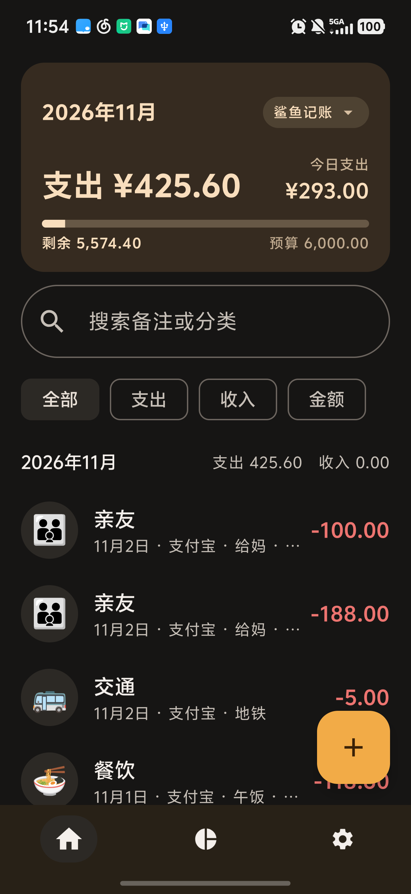
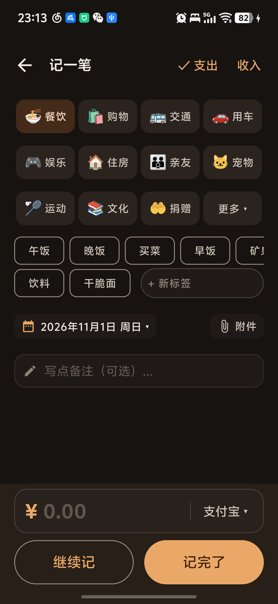
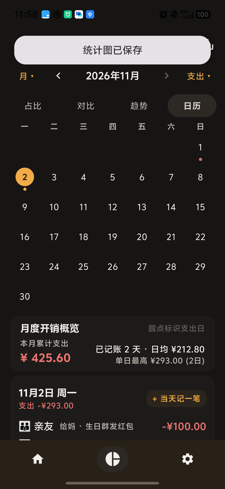
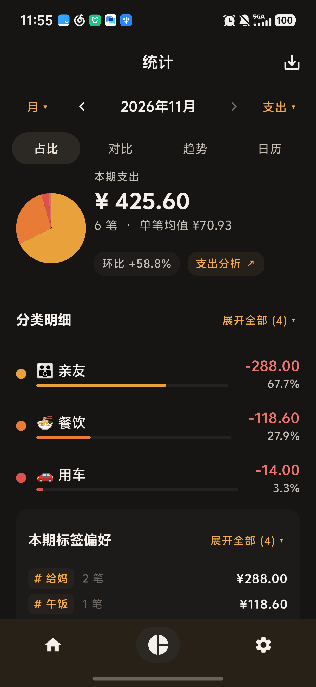
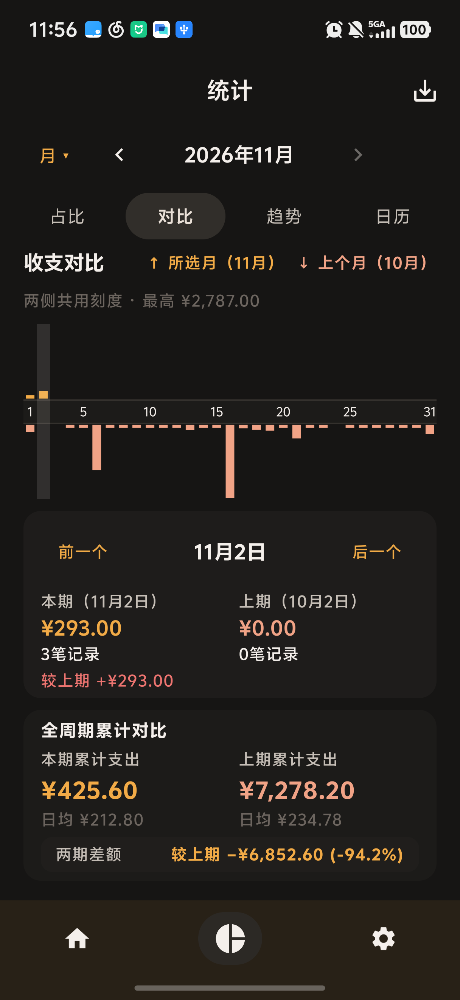
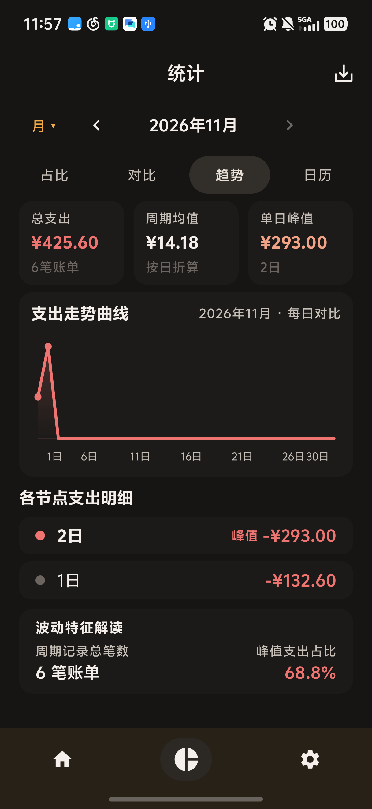
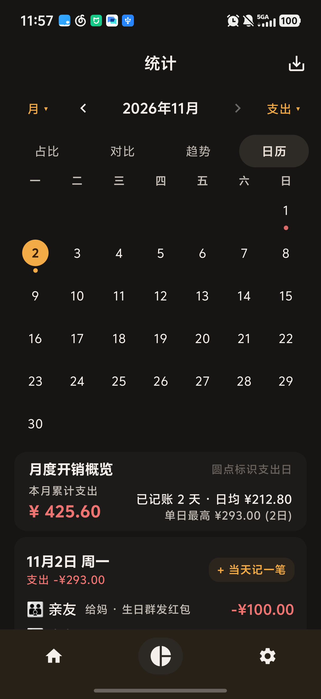
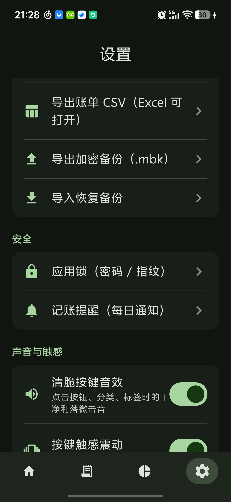
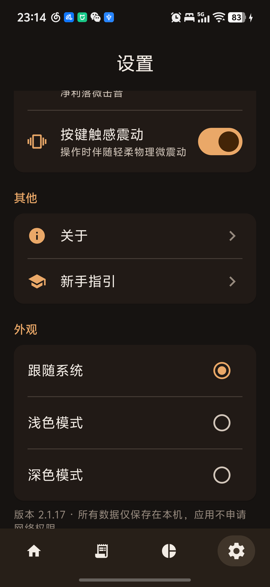
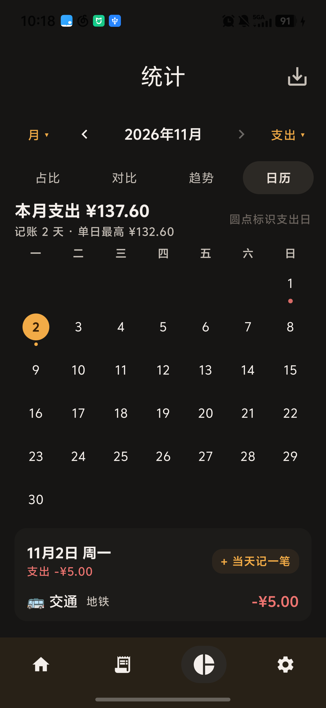

# 📒 记一笔（MoneyBook）

> 一款极致轻快、纯粹本地离线运行的 Android 个人记账应用。**零网络权限、零广告追踪、零账号体系**，所有数据严格保存在设备本地。

[](https://github.com/liaoyllv/moneybook/releases/latest)


「记一笔」（MoneyBook）专为追求高效记录与私密财务管理的用户量身打造，围绕**极速记账 → 资产管理 → 四维统计穿透 → 数据迁移与备份**全流程提供完整支持。应用基于 Kotlin + Jetpack Compose（Material 3）+ Room 构建，采用响应式 MVVM + Repository 架构，最低支持 Android 9.0，并针对现代主流机型（如 vivo X200 Pro mini / OriginOS 5、小米 HyperOS 等）的大字号与高对比度排版进行了像素级深度适配。

---

## 🌟 v2.1.21 核心重构与全新特性

在 **v2.1.21** 版本中，项目根据日常真实高频记账痛点，完成了从交互架构到视觉体系的重大重构升级：

1. **首页与账单深度整合**：打破传统独立账单页壁垒，将月度收支概览、预算进度条、全局关键词搜索、分类/账户/金额筛选胶囊与按月吸顶分组明细深度融合。底部导航栏收敛为 **首页、统计、设置** 3 Tab 紧凑布局，彻底消除加号位移跳动与多余过渡动画。
2. **全局顶部浮动胶囊通知（TopSnackbarHost）**：重塑操作反馈链路，全局所有保存、导出、设置通知统一在状态栏下方以半透明圆角胶囊浮动展现，**彻底根治底部通知被软键盘遮挡**的体验顽疾。
3. **记一笔全屏紧凑排列与秒开响应**：
   - 分类采用 **3x4 紧凑排列**，按历史使用频次加权自动前置最常用分类，第 12 格固定为「展开分类」；
   - 标签系统升级为 **行末即时输入与自动联想**：输入字符时自动带出历史已用标签，点击即可多选，同时保留自由文本备注；
   - 金额输入框与支付方式同排并列，默认预选常用账户（如支付宝），行内切换无需多层弹窗。
4. **统计中心单屏化与四维穿透**：
   - **日期筛选置顶**：全局置顶基准时间选择器，四大分析 Tab（占比、对比、趋势、日历）置于其下；
   - **占比**：左侧紧凑 Donut 环形图，右侧环比与单笔均值，分类明细与标签偏好高度固定超出展开，全屏铺满；
   - **对比**：120dp 铺满对称双向柱状图（以日期为中轴对比当月与上月同日），支持日/周/月/年切维保持当前 Tab，全周期累计对比整齐排版；
   - **趋势**：110dp 压缩折线图，三大核心 KPI 卡片，单日峰值与消费特征智能解读，无需滑动；
   - **日历**：星期栏置顶，月度开销概览（总支出、记账天数、单日最高）挪至日历下方，色块与日期数字优化适配，点击联动当日明细卡片；
   - 引入 **IQR（四分位距）异常支出候选挖掘**，辅助用户识别不必要开支。
5. **物理级清脆按键音效与触感震动反馈**：基于 SoundPool 44.1kHz 实现清脆利落的按键交互音效，配合短促物理微触感，并在设置页提供独立双开关自由控制。
6. **温暖舒缓的配色体系**：全新设计的暖色浅色调与高对比度深色模式，大字号排版下文字不折行、图标不重叠遮挡。
7. **外部账单全量迁移与分类合并**：内置外部数据导入器（如鲨鱼记账等），解析 CSV/Excel 并自动匹配分类与日期，一键全量无损迁移；支持将任意两分类合并，历史账单自动归属，当月预算自动相加。

---

## 🖼️ 界面预览（v2.1.21 真机截图）

以下截图均采集自物理真机实际运行效果（vivo X200 Pro mini，Android 15，大字体模式）：

### 💳 核心记账与主屏

| 首页与账单深度整合 | 记一笔分类 3x4 与标签联想 | 全局顶部浮动胶囊通知 |
| :---: | :---: | :---: |
|  |  |  |
| 聚合月度结余、预算进度与账单筛选 | 3x4 高频排列、标签联想与行内账户 | 状态栏下方悬浮，彻底避开软键盘遮挡 |

### 📊 统计中心单屏四维穿透

| 占比分析与标签展开 | 当月与上月同日对称对比 | 110dp 趋势折线图与 KPI | 日历星期置顶与月度概览 |
| :---: | :---: | :---: | :---: |
|  |  |  |  |
| Donut 图居左，分类与标签明细可展开 | 120dp 铺满对称柱状图，全周期整齐对齐 | 压缩折线图无需滑动，单日峰值与特征解读 | 星期置顶，月度开销下移，当日明细联动 |

### ⚙️ 设置、音效触感与视觉主题

| 设置中心与音效开关 | 温暖舒适色彩体系 | 深色模式与大字号日历 |
| :---: | :---: | :---: |
|  |  |  |
| 清脆音效、触感震动与多账本管理 | 精心调优的暖色浅色调设计系统 | 高对比度深色模式，大字号排版清晰规整 |

<details>
<summary><b>📂 点击展开查看经典基础功能截图（v2.0.0 归档）</b></summary>

| 功能模块 | 界面预览截图 |
| :--- | :--- |
| **基础分类与账户** |   |
| **多账本隔离** |   |
| **双层预算与预警** |    |
| **周期账单与存钱目标** |    |
| **安全锁与加密备份** |    |
| **桌面小组件与新手引导**|   |

</details>

---

## 🧭 功能全景

| 📝 极速记账 | 🗂 资产与管理 | 📊 单屏统计分析 | 🛡 安全与数据生态 |
| :--- | :--- | :--- | :--- |
| • 3x4 紧凑高频分类网格 | • 首页与账单深度整合 | • 日期筛选全局置顶 | • 零网络权限安全隔离 |
| • 标签行末即时输入与联想 | • 全局搜索与多维筛选胶囊 | • 占比 Donut 环形图与明细展开 | • AES-256-GCM 加密备份 |
| • 金额与支付方式同排并列 | • 分类合并（预算自动相加） | • 当月与上月同日对称柱状图 | • 外部账单全量导入（鲨鱼等） |
| • 日期默认当天/自由补账 | • 账户自定义排序与独立备注 | • 110dp 压缩折线图无需滑动 | • 账单附件无损打包备份 |
| • 连续记账与快速保存 | • 多套账本独立隔离与重命名 | • 日历星期置顶与月度概览下移 | • 数字密码 + 指纹应用锁 |
| • 备注保留与相册附件 | • 月度预算（保存自动返回） | • IQR 异常支出候选挖掘 | • CSV 表格导出 / JSON 备份 |
| • 清脆音效与触感震动反馈 | • 分类独立预算与超支警示 | • 图表原生 Canvas 导出 PNG | • Glance 桌面实时小组件 |

---

## 📚 软件工程文档

配套完整的软件工程规格与架构设计说明书（已全面同步至 v2.1.21）：

- [01-需求分析说明书](docs/01-需求分析.md)：25 项功能性需求与 8 项非功能性需求详述
- [02-系统总体设计](docs/02-系统架构.md)：分层架构图、E-R 数据库模型与关键业务时序
- [03-UML建模说明](docs/03-UML建模.md)：系统用例图与核心时序图（Mermaid 渲染）
- [04-测试方案与用例](docs/04-测试方案.md)：真机多设备验证、大字体排版与回归测试方案
- [05-软件设计说明书（论文）](docs/05-软件设计说明书.md)：基于 Jetpack Compose 的本地记账应用架构论证

---

## 🔨 构建与开发指南

<details open>
<summary><b>技术栈与本地构建</b></summary>

- **开发工具**：Android Studio Koala（2024.1.1）及以上，推荐使用 JDK 17
- **语言与核心库**：Kotlin 1.9.24 + Jetpack Compose（Material 3）+ Room 2.6.1 + DataStore 1.1.1
- **编译参数**：`compileSdk = 34`, `minSdk = 28`, `targetSdk = 34`
- **命令行构建**：
  ```bash
  # 编译 Debug 安装包
  ./gradlew assembleDebug

  # 编译 Release 安装包
  ./gradlew assembleRelease
  ```
- **发布签名配置**：在项目根目录 `local.properties`（不提交至 Git）中配置私钥信息：
  ```properties
  release.keystore=keystore/release.jks
  release.storePassword=your_store_password
  release.keyAlias=your_key_alias
  release.keyPassword=your_key_password
  ```

</details>

---

## 📋 版本更新历史

### v2.1.21（2026-11-02，当前最新版）
- **首页账单深度整合**：合并原独立账单页至首页，提供全局搜索、筛选胶囊与按月吸顶分组；底部导航收敛为首页/统计/设置 3 Tab
- **全局顶部胶囊通知**：统一封装 `TopSnackbarHost` 组件，所有操作反馈一律置顶，避免被输入法或手势底栏遮挡
- **统计中心单屏化深度重构**：日期筛选全局置顶；日历月度概览下移；趋势折线图压缩至 110dp；对比柱状图 120dp 铺满对称呈现；占比分类与标签支持自适应展开
- **交互与外观调优**：集成 SoundPool 44.1kHz 清脆按键音效与轻微触感震动反馈；全面适配暖色舒缓主题与大字体显示

### v2.1.0（2026-10-31）
- **记一笔全流程体验革新**：3x4 紧凑分类布局，按历史使用频次加权前置常用分类；标签行末即时联想输入；金额与支付方式并排
- **统计四维穿透**：新增上月与当月同日支出双向对称柱状图；引入 IQR 异常支出候选检测与标签细分统计下钻
- **数据治理与迁移**：支持外部记账数据（鲨鱼记账等）全量无损导入；支持分类合并与预算自动相加；支持账本重命名

### v2.0.0（2026-08-15，基础完备正式版）
- 确立「记一笔」品牌名称，完善分类、账户、多账本、双层预算、周期账单、存钱目标、加密备份、指纹锁与桌面小组件等基础架构

---

## 📄 开源许可证与二次开发

- 本项目基于宽松的 [MIT License](LICENSE) 协议开源。
- 允许自由 Fork、修改、重构、二次开发或个人定制使用。
- 衍生开发仓库：[https://github.com/liaoyllv/moneybook](https://github.com/liaoyllv/moneybook)
- 原作者版权声明：Copyright (c) 2026 AndersOnLin4；二次开发重构：Copyright (c) 2026 liaoyllv。
