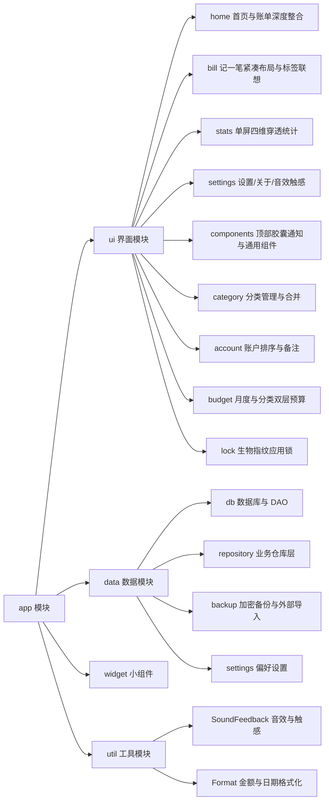
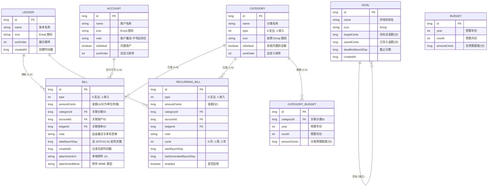

# 记一笔（MoneyBook）系统总体设计

> 文档版本：v2.1 ｜ 对应软件版本：记一笔 v2.1.21（最新发布版） ｜ 更新日期：2026-11-02 ｜ 代码仓库：https://github.com/liaoyllv/moneybook

## 1. 总体架构

系统采用 **MVVM + Repository 分层架构**，结合 Jetpack Compose 的单向数据流（UDF）与响应式状态流（StateFlow）模式进行深度优化：

```mermaid
graph TD
    subgraph UI交互层 (Jetpack Compose)
        A1[HomeScreen<br/>首页+账单整合+搜索筛选]
        A2[StatsScreen<br/>四维单屏穿透统计中心]
        A3[SettingsScreen<br/>偏好设置与多账本管理]
        A4[AddEditBillScreen<br/>记一笔3x4分类+标签联想]
        A5[TopSnackbarHost<br/>全局状态栏下浮动胶囊通知]
    end

    subgraph 视图模型层 (ViewModel)
        B1[HomeViewModel<br/>月度聚合+账单检索]
        B2[StatsViewModel<br/>单屏自适应+四维分析]
        B3[SettingsViewModel<br/>音效/备份/导入/主题]
        B4[AddEditBillViewModel<br/>分类高频排序+标签联想]
        B5[TopSnackbarManager<br/>全局事件总线 StateFlow]
    end

    subgraph 仓库业务层 (Repository)
        C1[BillRepository<br/>账单事务与月度吸顶]
        C2[CategoryRepository<br/>分类排序与合并预算]
        C3[AccountRepository<br/>账户排序与备注转移]
        C4[LedgerRepository<br/>账本隔离与重命名]
        C5[BudgetRepository<br/>双层预算联动校验]
        C6[SharkBillImporter<br/>外部数据解析与无损导入]
    end

    subgraph 本地数据层 (Room + DataStore)
        D1[Room DAO<br/>SQLite 数据访问接口]
        D2[(SQLite 数据库<br/>moneybook.db v4)]
        D3[DataStore Preferences<br/>主题/锁/音效/震动/活跃账本]
    end

    subgraph 系统与硬件服务
        E1[SoundFeedback<br/>SoundPool 44.1kHz按键音]
        E2[VibratorManager<br/>物理级轻微触感震动]
        E3[BiometricPrompt<br/>系统生物指纹验证]
        E4[WorkManager<br/>本地离线记账提醒]
        E5[Glance Widget<br/>桌面快捷小组件]
        E6[SAF & FileProvider<br/>加密备份与图片附件]
    end

    A1 & A2 & A3 & A4 -->|"观察 StateFlow"| B1 & B2 & B3 & B4
    A5 -.->|"订阅单向事件"| B5
    B1 & B2 & B3 & B4 -->|"业务调度"| C1 & C2 & C3 & C4 & C5 & C6
    B1 & B2 & B3 & B4 -.->|"触发通知"| B5
    C1 & C2 & C3 & C4 & C5 & C6 --> D1 --> D2
    C1 & C2 & C3 & C4 & C5 & C6 --> D3
    B3 & B4 -.->|"交互反馈"| E1 & E2
    A3 -.->|身份鉴权| E3
    C5 -.->|后台守护| E4
    E5 -.->|实时读取| C1
    C6 & A4 -.->|沙箱文件访问| E6
```

---

## 2. 模块划分与目录职责



### 核心包路径说明：
- `com.andersonlin.moneybook.ui.home`：合并后的首页主屏，涵盖月度结余概览、预算进度条、账单按月吸顶分组、全局搜索、分类/账户/金额筛选胶囊。
- `com.andersonlin.moneybook.ui.bill`：记一笔核心交互，3x4 分类紧凑排列、使用频次加权前置、行末即时标签联想、金额与支付方式并排。
- `com.andersonlin.moneybook.ui.stats`：单屏化统计中心，日期筛选全局置顶，涵盖占比（Donut 环形图与展开明细）、对比（120dp 对称柱状图）、趋势（110dp 压缩折线图与 KPI）、日历（星期置顶与月度概览下移）。
- `com.andersonlin.moneybook.ui.components.TopSnackbarHost`：全局顶部半透明圆角胶囊浮层，彻底解决底部通知遮挡痛点。
- `com.andersonlin.moneybook.util.SoundFeedback`：基于 SoundPool 与 Vibrator 的低延迟清脆音效和微触感震动引擎。
- `com.andersonlin.moneybook.data.repository.CategoryRepository`：分类合并算法、频次排序权重与预算自动累加相加。

---

## 3. 数据库设计（E-R 模型）

系统底层采用 Room 2.6.1（SQLite v4）持久化，核心实体关系如下：



---

## 4. 关键业务流程与机制

### 4.1 全局顶部胶囊通知机制
为杜绝 Android 原生 Snackbar 位于屏幕底部容易被软键盘、手势导航栏遮挡的顽疾，系统设计了 `TopSnackbarHost` 架构：
1. `TopSnackbarManager` 作为单例事件总线，持有 `StateFlow<SnackbarMessage?>`；
2. 任何界面（如设置保存、记账完成、预算更新、数据导出）通过调用 `TopSnackbarManager.show(text)` 发送通知；
3. `MainActivity` 根级脚手架顶层在状态栏下方渲染悬浮胶囊，支持自动淡入淡出、平滑滑入、超时自动收起。

### 4.2 记一笔分类高频排序与标签智能联想
1. 记一笔加载时，Repository 统计最近账单中各分类的使用频次，根据频次权重动态将最常用的分类置于前 11 格，第 12 格固定为「展开分类」；
2. 用户选择分类后，自动加载历史绑定的标签池；
3. 用户在行末输入框输入字符时，实时前缀过滤匹配，点击候选标签原地高亮选中，确认输入时自动创建新标签，一笔账单支持多标签组合并留存自由备注。

### 4.3 分类合并与预算累加算法
当用户触发合并分类操作时（源分类 A → 目标分类 B）：
1. 在同一事务内更新所有 `categoryId = A` 的账单，将其批量变更为 `categoryId = B`；
2. 针对分类预算表 `category_budgets`，查询同一月份下 A 与 B 的预算记录：若两方均有预算，则将 A 的预算金额累加至 B 并删除 A 的预算；若仅 A 存在预算，则将其分类归属变更为 B；
3. 转移完成后安全删除源分类 A，保障财务数据平滑统一。

### 4.4 统计单屏化渲染与图表解耦
1. 采用「日期筛选器全局置顶 + 四大 Tab 置底」的直觉式布局；
2. 切换日/周/月/年时间跨度时，保持当前所在 Tab（如正在看对比则继续留在对比），消除跳页带来的困扰；
3. 各 Tab 严格设定自适应高度与紧凑尺寸（趋势折线图 110dp、对比柱状图 120dp 铺满），在大字号机型上全屏尽览无需上下滑动；明细部分支持受限自适应展开。
