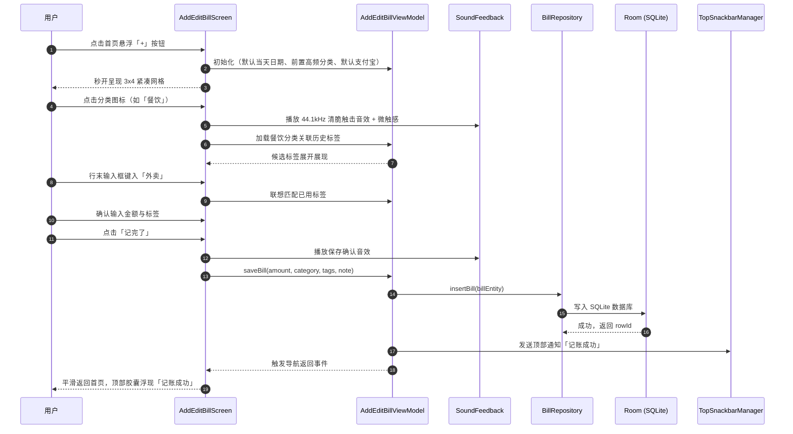
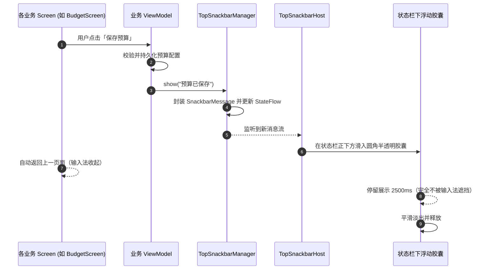
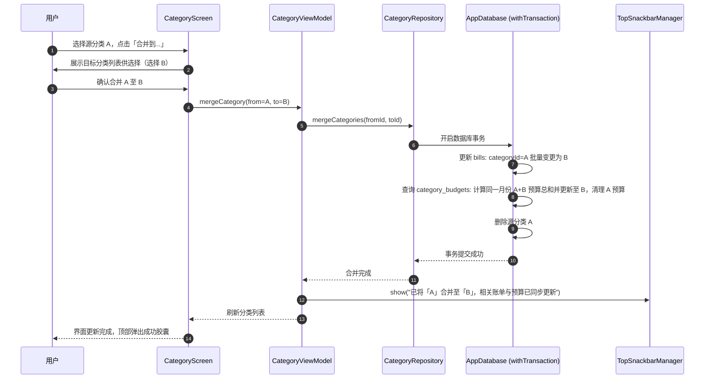
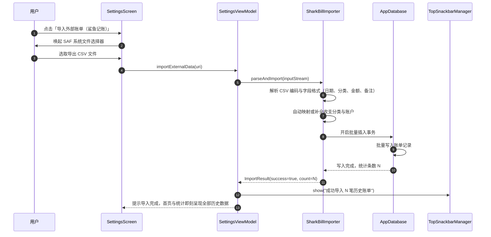

# 记一笔（MoneyBook）UML 建模

> 文档版本：v2.1 ｜ 对应软件版本：记一笔 v2.1.21（最新发布版） ｜ 更新日期：2026-11-02 ｜ 代码仓库：https://github.com/liaoyllv/moneybook
> 图表使用 Mermaid 规范绘制（支持 GitHub 原生高质量渲染）。

## 1. 系统用例图

### 1.1 总体用例全景图

```mermaid
flowchart LR
    U((用户))
    subgraph 记一笔系统 (v2.1.21)
        UC1[记一笔极速记账]
        UC2[首页账单整合浏览与检索]
        UC3[四维单屏穿透统计分析]
        UC4[多账本与分类账户管理]
        UC5[双层预算设置与超支预警]
        UC6[数据安全与外部账单迁移]
        UC7[交互反馈与外观设置]
        UC8[桌面快捷小组件]
    end

    U --> UC1
    U --> UC2
    U --> UC3
    U --> UC4
    U --> UC5
    U --> UC6
    U --> UC7
    U --> UC8

    UC1 -.->|include| UC11{{分类3x4高频选择}}
    UC1 -.->|include| UC12{{标签多选与联想输入}}
    UC1 -.->|extend| UC13{{附加相册图片/文件}}
    UC1 -.->|extend| UC14{{连续记账模式}}
    UC2 -.->|include| UC21{{关键词全局搜索}}
    UC2 -.->|include| UC22{{分类/账户/金额筛选}}
    UC3 -.->|include| UC31{{占比Donut图与明细展开}}
    UC3 -.->|include| UC32{{当月上月同日对称对比}}
    UC3 -.->|include| UC33{{110dp趋势折线图与KPI}}
    UC3 -.->|include| UC34{{日历月度概览与补账}}
    UC4 -.->|extend| UC41{{分类合并与预算累加}}
    UC4 -.->|extend| UC42{{账本重命名与账户备注}}
    UC6 -.->|extend| UC61{{鲨鱼记账等全量导入}}
    UC6 -.->|include| UC62{{AES-256 加密备份}}
    UC7 -.->|include| UC71{{清脆音效与触感开关}}
    UC7 -.->|include| UC72{{暖色调与深色主题切换}}
```

---

## 2. 核心交互时序图

### 2.1 记一笔极速记账与标签即时联想



### 2.2 全局顶部胶囊通知调度机制



### 2.3 分类合并与预算累加流程



### 2.4 外部账单（鲨鱼记账）全量迁移导入


